# FP-growth in C++ and CUDA

   

Frequent-itemset mining with the **FP-growth** algorithm (Han, Pei & Yin, SIGMOD 2000),
implemented twice: as a classic sequential C++ program and as a data-parallel CUDA
program that builds the FP-tree and mines it entirely on the GPU. Course project for
ESE 327 (Project 1), Stony Brook University.

**Highlights**

* **Up to 13× faster on a desktop GPU and 16× on an embedded one.** The speedup over an
  optimized sequential C++ FP-growth is 13.2× on an RTX 3060 Ti and 15.7× on a Jetson Orin
  Nano (poker, 1 M transactions). On census (56 M frequent itemsets) the GPU takes 2.8 s
  versus 22.7 s on the CPU.
* **Exact results everywhere.** CPU and GPU produce the same itemsets and supports at all
  194 benchmark points on both machines. They also pass 260 correctness tests against
  hand-checked textbook examples and an independent Apriori miner.
* **A GPU-friendly reformulation of FP-growth** with no pointer-based tree insertion and no
  conditional trees. The tree is built level by level with radix sorts, and conditional
  pattern bases are flat lists of pointers into one global tree, merged with
  sort + reduce-by-key.
* **Bounded memory.** The GPU uses at most 0.81 GB of device memory across all runs, set by
  configurable batch budgets rather than by the number of itemsets.
* **13 benchmark datasets** from the UCI Machine Learning Repository, from 435 to
  1,025,010 transactions, downloaded and converted by one script.

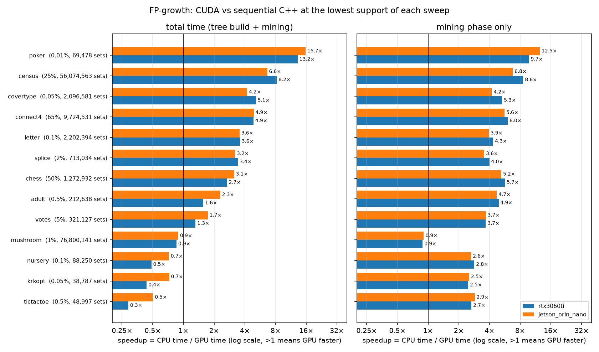

---

## Contents

* [Results](#results)
* [How it works](#how-it-works)
* [Correctness](#correctness)
* [Datasets](#datasets)
* [Building](#building)
* [Usage](#usage)
* [Reproducing the benchmarks](#reproducing-the-benchmarks)
* [Discussion](#discussion)
* [Limitations and future work](#limitations-and-future-work)
* [Repository layout](#repository-layout)
* [References](#references)

## Results

### Machines

| | Desktop | Embedded |
|---|---|---|
| CPU (runs `fpgrowth_cpu`, single-threaded) | Intel Core i5-12400F, 32 GB RAM | Jetson Orin Nano, 6-core Arm Cortex-A78AE |
| GPU (runs `fpgrowth_gpu`) | NVIDIA GeForce RTX 3060 Ti: 38 SMs, 8 GB GDDR6, compute capability 8.6 | Orin integrated Ampere GPU: 8 SMs, compute capability 8.7 |
| Memory | separate host RAM and GPU memory (PCIe) | 8 GB LPDDR5 shared by CPU and GPU |
| Software | Windows 11; g++ 14.2 `-O3`; CUDA 11.8 + MSVC 14.50, `-arch=sm_86` | JetPack (Linux) |

### Lowest support of each sweep

Times are tree construction + mining in milliseconds (median of 3 runs), excluding file
reading and writing. Speedup = CPU time / GPU time. Peak GPU memory is identical on both
machines because batch sizes are deterministic.

| dataset | transactions | min sup | frequent itemsets | desktop CPU | desktop GPU | **speedup** | Jetson CPU | Jetson GPU | **speedup** | GPU mem (MB) |
|---|---:|---:|---:|---:|---:|---:|---:|---:|---:|---:|
| poker | 1,025,010 | 0.01% | 69,478 | 1,954 | 148 | **13.2×** | 5,071 | 322 | **15.7×** | 267 |
| census | 299,285 | 25% | 56,074,563 | 22,670 | 2,760 | **8.2×** | 32,798 | 4,947 | **6.6×** | 809 |
| covertype | 581,012 | 0.05% | 2,096,581 | 3,843 | 749 | **5.1×** | 7,593 | 1,805 | **4.2×** | 593 |
| connect-4 | 67,557 | 65% | 9,724,531 | 1,910 | 393 | **4.9×** | 2,614 | 535 | **4.9×** | 209 |
| letter | 20,000 | 0.1% | 2,202,394 | 1,081 | 303 | **3.6×** | 1,869 | 526 | **3.6×** | 401 |
| splice | 3,190 | 2% | 713,034 | 1,656 | 485 | **3.4×** | 3,144 | 982 | **3.2×** | 417 |
| chess | 3,196 | 50% | 1,272,932 | 356 | 133 | **2.7×** | 498 | 159 | **3.1×** | 35 |
| adult | 48,842 | 0.5% | 212,638 | 134 | 85 | **1.6×** | 226 | 98 | **2.3×** | 43 |
| votes | 435 | 5% | 321,127 | 126 | 96 | **1.3×** | 190 | 109 | **1.7×** | 23 |
| mushroom | 8,124 | 1% | 76,800,141 | 1,745 | 2,041 | 0.86× | 2,775 | 3,117 | 0.89× | 682 |
| nursery | 12,960 | 0.1% | 88,250 | 35 | 71 | 0.49× | 55 | 77 | 0.72× | 14 |
| krkopt | 28,056 | 0.05% | 38,787 | 29 | 67 | 0.44× | 53 | 73 | 0.72× | 21 |
| tic-tac-toe | 958 | 0.5% | 48,997 | 20 | 69 | 0.29× | 36 | 72 | 0.50× | 5 |

Every point of every sweep, with build and mine times and peak host and device memory, is
in [`results/rtx3060ti/summary.md`](results/rtx3060ti/summary.md) and
[`results/jetson_orin_nano/summary.md`](results/jetson_orin_nano/summary.md). The raw data
is in the `bench.csv` next to each summary.

### Per-dataset plots

Each figure shows, against minimum support: runtime for CPU and GPU (log scale), the
number of frequent itemsets, peak host and device memory, and the GPU speedup.

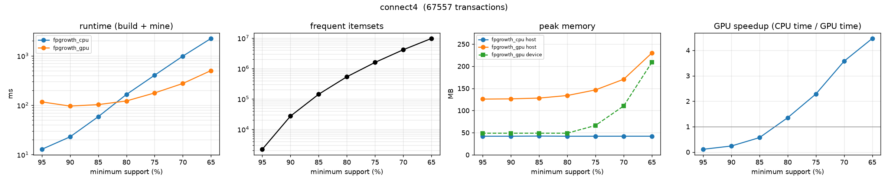
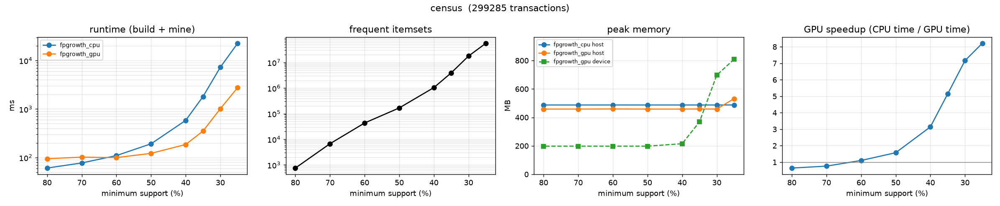

<details>
<summary><b>All datasets: desktop (RTX 3060 Ti)</b></summary>

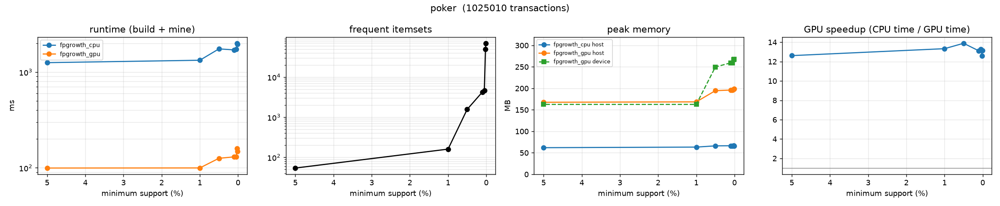
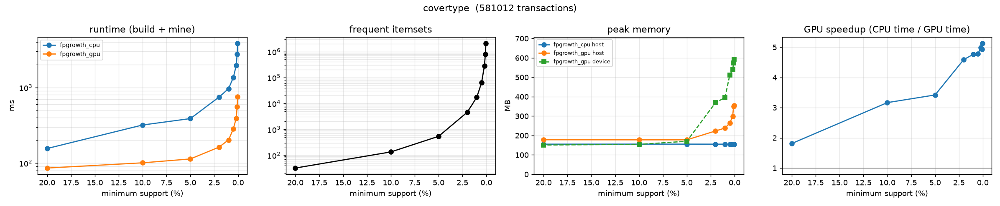
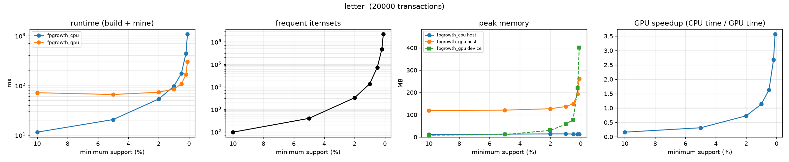
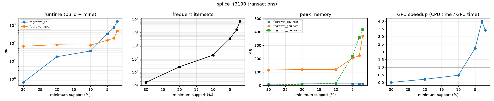
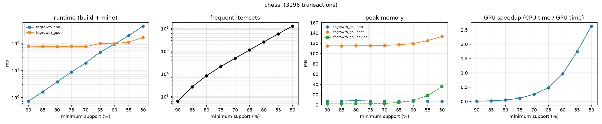
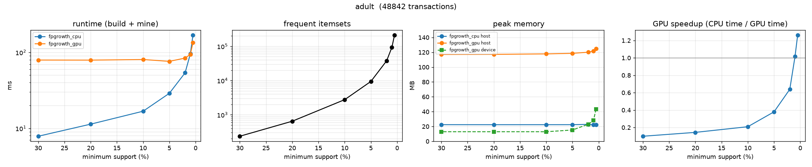
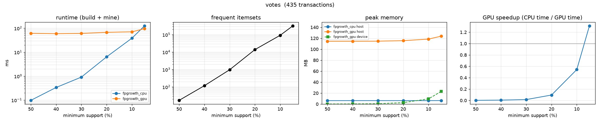
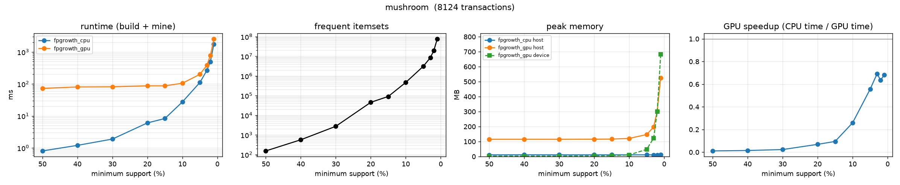
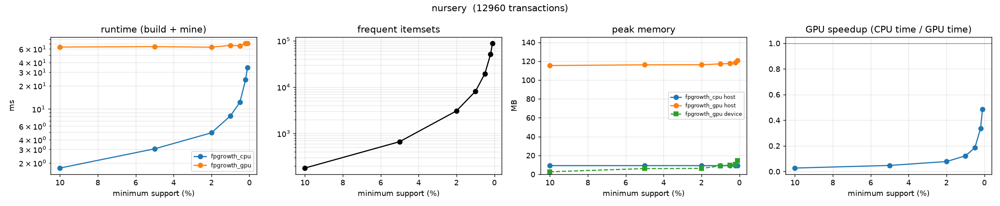
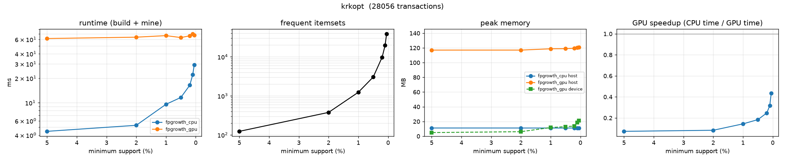
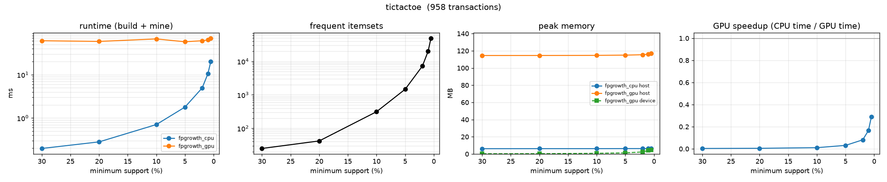

</details>

<details>
<summary><b>All datasets: Jetson Orin Nano</b></summary>

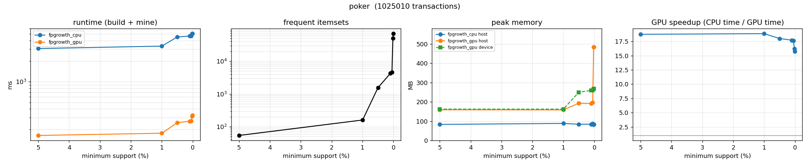
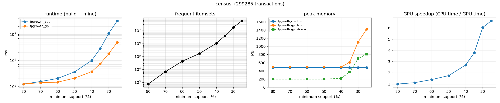
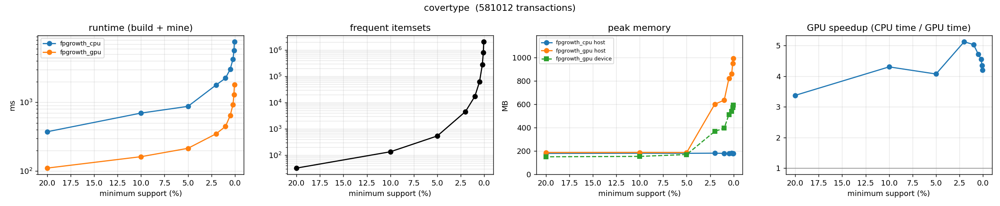
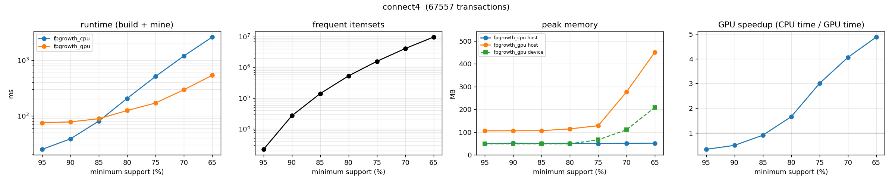
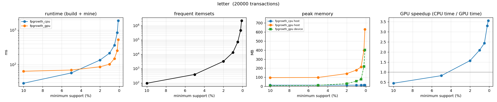
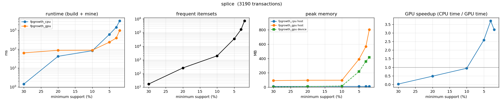
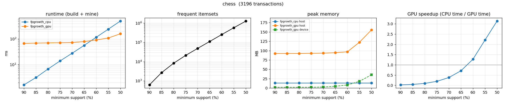
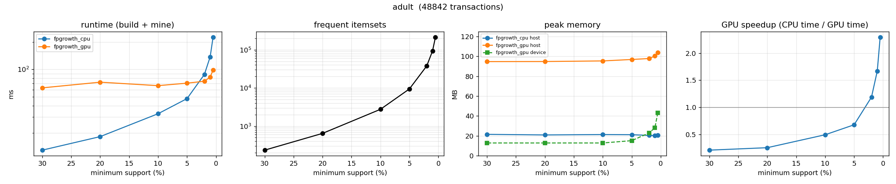
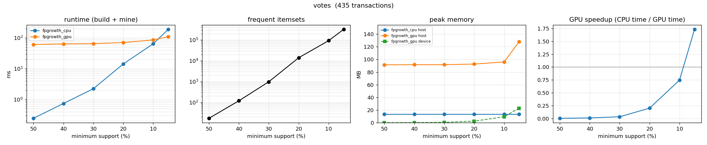
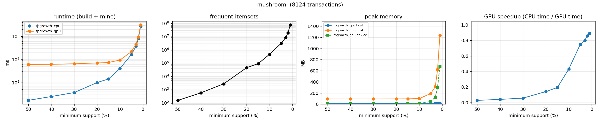
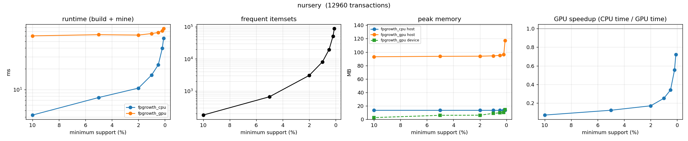
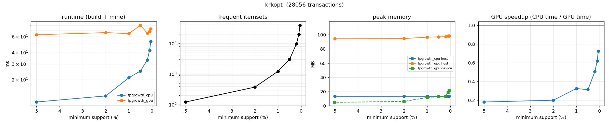
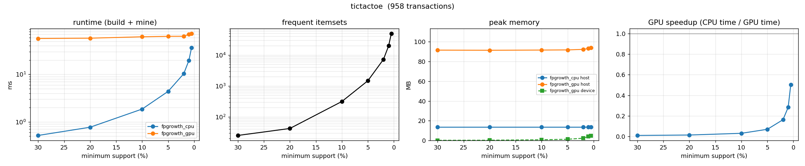

</details>

## How it works

| program | source | description |
|---|---|---|
| `fpgrowth_cpu` | `src/fpgrowth_cpu.cpp` | classic sequential FP-growth: FP-tree plus recursive conditional FP-trees |
| `fpgrowth_gpu` | `src/fpgrowth_gpu.cu` | data-parallel CUDA FP-growth: tree construction and mining on the GPU |
| `fpgrowth_gpu_emu` | same `.cu` file | the CUDA code compiled by a plain C++ compiler with serial kernel emulation, for testing without an NVIDIA GPU |

All three read the same input, use the same item order and write identical results, so
each can check the others.

### Sequential FP-growth (`fpgrowth_cpu`)

1. **First scan.** Count every item's support, keep items with support ≥ the minimum count,
   and rank them by descending support (rank 0 = most frequent).
2. **FP-tree.** Insert each transaction's frequent items, sorted by rank, into a prefix
   tree. Shared prefixes share nodes, and each node stores a count. Nodes holding the same
   item are chained by node-links from a header table that also stores each item's total
   support. All nodes live in flat arrays.
3. **Mining** `mine(tree, suffix)`. For each item `i` of the tree, from least to most
   frequent:
   * output `suffix ∪ {i}` with the header count of `i` as its support;
   * the **conditional pattern base** of `i` is the prefix path above every `i`-node,
     weighted by that node's count. One pass over these paths counts the conditional
     support of each item. A second pass inserts the paths, keeping only items that are
     still frequent, into a **conditional FP-tree**, which is mined recursively with
     suffix `suffix ∪ {i}`;
   * **single-path shortcut:** when a tree is a single chain, every subset of the chain is
     frequent, with support equal to the count of its deepest node, so all subsets are
     enumerated directly.

### CUDA FP-growth (`fpgrowth_gpu`)

FP-growth's recursion and pointer chasing map poorly onto a GPU. The CUDA version keeps
the FP-tree / pattern-growth idea but expresses every step as flat, data-parallel array
operations: custom kernels plus CUB radix sort, exclusive scan and reduce-by-key.

| phase | parallelism | what happens |
|---|---|---|
| 1. item counting | one thread per item occurrence | `atomicAdd` into a support histogram; the host ranks the frequent items |
| 2. ranking | one thread per transaction | drop infrequent items and insertion-sort the rest by rank, in place |
| 3. FP-tree build | one thread per transaction, one pass per depth level | sort-based trie construction (below) |
| 4. mining | one thread per conditional-pattern-base entry | pointer-based pattern growth (below) |

**Building the tree without pointer insertion.** The FP-tree is exactly the prefix trie of
the ranked transactions. At depth `d`, every transaction longer than `d` forms the 64-bit
key `(node reached at depth d-1, its d-th item)`, and the keys are radix-sorted. A flag and
scan pass then gives each distinct key a new node id, with parent and item read from the
key. The node's count is the number of transactions with that key, and each transaction
records the node it reached. After `max transaction length` levels the tree is complete. It
is stored as flat `parent[] / item[] / count[]` arrays on the device and is identical to
the CPU tree.

**Mining with pointer-based conditional pattern bases.** The conditional pattern base of
an itemset `P` is a list of entries `(node, count)`, where `node` is the top of a prefix
path in the *global* tree. For a single item `i`, the entries are `(parent(n), count(n))`
for every `i`-node `n`. A batch of patterns is processed in four steps:

1. **Count extensions.** One thread per entry walks from `node` to the root and atomically
   adds `count` to `support[P][j]` for every item `j` on the path.
2. **Select.** Every `(P, j)` with `support ≥ min count` becomes a new frequent itemset
   `P ∪ {j}` (flags, exclusive scan, scatter).
3. **Build child bases.** Each entry walks its path again. Wherever a frequent extension
   `j` sits at node `a`, it emits `(child id, parent(a), count)`. Radix sort and
   reduce-by-key then merge identical prefix paths. This is the same compression that node
   sharing gives a conditional FP-tree.
4. **Schedule.** The child bases become new batches on a host-side stack, processed depth
   first. Small batches are concatenated so each launch fills the GPU, and large ones are
   split so memory stays within `--max-entries` and `--max-cands`.

No conditional tree is ever allocated, and every step is a regular kernel, sort or scan.
The trade-off is that path walks also visit items that are infrequent in the conditional
database, which a CPU conditional tree would have pruned.

**Why it is exact.** An entry `(node, c)` of `P` stands for `c` transactions that contain
`P` and whose remaining higher-ranked frequent items are exactly the path from `node` to
the root. So the support of `P ∪ {j}` is the sum of `c` over the entries whose path
contains `j`, which is what step 1 computes. Those transactions' remaining items are the
path above `j`'s node, which is what step 3 emits. This is the FP-growth recursion over
conditional pattern bases, with the same item order.

**Testing without a GPU.** `include/cuda_compat.h` wraps the CUDA runtime and CUB, and
tracks device memory. When it is compiled without `nvcc`, it maps `__global__`,
`threadIdx`, `atomicAdd`, device memory and the CUB primitives to serial C++. Every kernel
is a grid-stride loop without shared memory or `__syncthreads`, so running a launch as one
thread gives exactly the GPU result. The whole GPU algorithm, including batch splitting and
merging, was validated this way before it ever ran on a GPU, and it then ran unchanged on
both machines.

## Correctness

`python scripts/run_tests.py` runs every built binary. The GPU binaries run a second time
with tiny batch budgets (`--max-entries 7 --max-cands 5`) to force many batch splits and
merges. The tests cover:

1. **Textbook examples** with hand-checked results (`data/examples/`):
   * Han & Kamber, *Data Mining*, Table 6.1 (9 transactions, min_sup = 2): 13 itemsets,
     such as `{I1,I2,I5}:2`. The FP-tree has 10 nodes plus the root, as in the book's
     figure;
   * the running example of the FP-growth paper (5 transactions, min_sup = 3): 18
     itemsets, such as `{f,c,a,m}:3`.
2. **45 randomized and edge-case datasets**: empty result, single transaction, identical
   transactions (single-path tree), nested chains, duplicate items, sparse and dense,
   skewed and uniform. Each is compared with an independent Python Apriori miner
   (`scripts/bruteforce.py`) that shares no code with the C++.
3. **UCI data**: Apriori against both programs at high support, and CPU against GPU at
   lower support (for example mushroom at 15%, 90,325 itemsets), with default and small
   batch budgets.

**Result: 260 passed, 0 failed** (`fpgrowth_cpu`, `fpgrowth_gpu` on the RTX 3060 Ti, and
`fpgrowth_gpu_emu`). In addition:

* CPU and GPU report the same itemset counts at all 194 benchmark points on each machine,
  and both machines agree with each other point for point;
* the counts match published FIMI-repository figures for the same UCI data: chess at 90%
  gives 622 itemsets and connect-4 at 95% gives 2,201.

## Datasets

All benchmarks come from the [UCI Machine Learning Repository](https://archive.ics.uci.edu/).
`python scripts/fetch_uci.py` downloads them into `data/raw/` and converts them into
transaction files in `data/uci/` (one transaction per line). Categorical records become
`attribute=value` items, and missing values (`?`) are dropped.

| dataset | UCI id | transactions | items | avg. length | conversion |
|---|---|---:|---:|---:|---|
| votes | 105 | 435 | 34 | 16.1 | `issue=y/n`, missing votes dropped |
| tic-tac-toe | 101 | 958 | 29 | 10.0 | `square=x/o/b` + class |
| splice | 69 | 3,190 | 290 | 61.0 | `pNN=base` for the 60 DNA positions + class |
| chess (kr-vs-kp) | 22 | 3,196 | 75 | 37.0 | `attribute=value` |
| mushroom | 73 | 8,124 | 118 | 22.7 | `attribute=value` |
| nursery | 76 | 12,960 | 32 | 9.0 | `attribute=value` |
| letter | 59 | 20,000 | 282 | 17.0 | `feature=value` (16 integer features) + letter |
| krkopt | 23 | 28,056 | 58 | 7.0 | piece files/ranks + result |
| adult | 2 | 48,842 | 114 | 12.9 | train + test; age, hours and capital gain/loss binned; `fnlwgt`, `education-num` dropped |
| connect-4 | 26 | 67,557 | 129 | 43.0 | `square=x/o/b`; the `.Z` archive is decoded by the script |
| census (KDD) | 117 | 299,285 | 522 | 38.9 | train + test; age and weeks worked binned, money columns `none`/`positive`, instance weight dropped |
| covertype | 31 | 581,012 | 101 | 13.0 | 10 numeric attributes as quintiles, wilderness area, soil type, cover type |
| poker | 158 | 1,025,010 | 62 | 6.0 | train + test; the five cards as a basket (`10H`, `QS`, ...) + `hand=class` |
| online retail (optional) | 352 | ~20k invoices | ~4k | ~20 | baskets of stock codes; needs `pip install openpyxl` |

## Building

Requirements: a C++17 compiler; for the GPU version, the CUDA Toolkit (11.6+ for
`-arch=native`; CUB ships with the toolkit). The scripts need Python 3 and matplotlib.

**Linux / Jetson / Google Colab** (Makefile):

```bash
make            # fpgrowth_cpu + fpgrowth_gpu_emu, plus fpgrowth_gpu if nvcc is on PATH
make gpu        # only the CUDA build
make gpu CUDA_ARCH=-arch=sm_75   # explicit architecture, e.g. T4 = sm_75, RTX 30xx = sm_86, Orin = sm_87
```

**Windows.** `nvcc` requires MSVC as its host compiler, so use CMake from a
"x64 Native Tools" Visual Studio prompt:

```bash
cmake -B build -DCMAKE_BUILD_TYPE=Release
cmake --build build --config Release      # builds fpgrowth_gpu when CUDA is found
```

The CPU and emulation builds also work with MSYS2/MinGW `g++` and `mingw32-make`.

<details>
<summary>Notes on the benchmarked Windows build</summary>

Visual Studio 2026 (MSVC 14.50) needs CUDA 12.4 or newer. The benchmarked binary was
instead built with the CUDA 11.8 toolkit bundled with MATLAB R2023b. That needed
`-allow-unsupported-compiler -D_ALLOW_COMPILER_AND_STL_VERSION_MISMATCH`, explicit `-I`/`-L`
paths to its `include` and `lib\x64`, and a manual link against `cudart_static.lib`
(that copy has no `cudadevrt.lib`).

</details>

## Usage

```
fpgrowth_cpu <transactions.txt> <minsup> [-o itemsets.txt] [--json] [--quiet]
fpgrowth_gpu <transactions.txt> <minsup> [-o itemsets.txt] [--json] [--quiet]
             [--max-entries N] [--max-cands N]
```

* **Input**: one transaction per line, items separated by whitespace. Any token is an
  item (`I1`, `42`, `odor=n`, ...), and duplicate items in a line are ignored.
* **minsup**: relative (`0.3` or `30%`, meaning `ceil(0.3 × #transactions)`) or an
  absolute transaction count (`3`).
* **Output** (`-o`): one itemset per line, items sorted, then its support, e.g.
  `I1 I2 I5 #SUP: 2`. Without `-o`, itemsets are counted but not written, which is how the
  timings were measured.
* **Statistics**: dataset size, FP-tree size, itemsets by length, time per phase, peak
  host memory and (GPU) peak device memory. `--json` prints them as one JSON line.
* `--max-entries` / `--max-cands` bound the GPU working set per mining batch (default 8 M
  each; at most 0.81 GB in all benchmarks).

```
$ ./bin/fpgrowth_gpu data/examples/han_textbook.txt 2 -o out.txt
frequent items   : 5
FP-tree nodes    : 11
frequent itemsets: 13
    size 1        : 5
    size 2        : 6
    size 3        : 2
$ head -3 out.txt
I2 #SUP: 7
I1 #SUP: 6
I3 #SUP: 6
```

## Reproducing the benchmarks

```bash
python3 scripts/fetch_uci.py                       # all 13 datasets (~470 MB of converted text)
python3 scripts/run_tests.py                       # correctness suite for every built binary
python3 scripts/benchmark.py --out results/<machine>               # CPU + GPU support sweeps
python3 scripts/compare_machines.py results/rtx3060ti results/jetson_orin_nano   # overview figure
```

`benchmark.py` takes the median of 3 runs per point and stops lowering the support once a
run takes longer than 60 s. It writes `bench.csv`, `summary.md` and one figure per dataset.

## Discussion

* **The GPU wins on large or dense inputs.** The biggest gains come where there is a lot
  of parallel work. Poker has 1 M short transactions and builds a 1.28 M-node tree: the
  desktop CPU spends 1.24 s counting items and building the tree, while the GPU spends
  75 ms on the same phase, CUDA startup included. Census, covertype and connect-4 produce millions of
  itemsets from wide conditional bases and gain 4–8×.
* **Small inputs pay a fixed startup cost.** Every GPU run includes about 55–80 ms of CUDA
  context creation, which lands in the build phase because it happens at the first device
  allocation. Inputs that the CPU mines in under about 100 ms (tic-tac-toe, nursery,
  krkopt, and every dataset at high support) are therefore slower end to end on the GPU,
  even though GPU mining alone is still 2.5–2.9× faster on them.
* **Mushroom is the exception.** At 77 M itemsets GPU mining is still slightly slower.
  Mushroom's FP-tree is tiny (26 k nodes), so the CPU's conditional trees stay small and
  cache-resident and it produces 44 M itemsets/s. The GPU's path walks also visit items
  that those conditional trees would have pruned.
* **The embedded GPU is closer to the desktop GPU than its hardware suggests.** The Orin
  GPU has about 1/5 the SMs of the RTX 3060 Ti and a fraction of its memory bandwidth, yet
  its mining phase is only 1.5–2.5× slower. Its CPU is 1.4–2.6× slower than the desktop
  CPU, so speedups are similar on both machines, and higher on the Jetson for poker
  (15.7×). The current implementation does not saturate the desktop GPU. Each batch makes
  several host–device round trips (result counts, child lists, the next batch) and much of
  the remaining cost is latency rather than compute.
* **Runtime tracks output size; memory does not.** Once mining dominates, CPU time grows
  almost linearly with the number of itemsets: about 44 M/s on mushroom and 5 M/s on
  connect-4. CPU peak RAM is set by the input and the global FP-tree, not by the output,
  because itemsets are streamed out. It is flat across each sweep, from 6 MB (tic-tac-toe)
  to 488 MB (census). GPU device memory grows with the batch sizes but is capped by the
  batch budgets (at most 809 MB).
* **Host memory on the GPU runs.** On the desktop, GPU runs use about 100 MB more host RAM
  than CPU runs, because of the CUDA runtime. On the Jetson, CPU and GPU share the same
  DRAM, and the reported peak host memory for GPU runs is much higher (e.g. 1,417 MB for
  census versus 532 MB on the desktop). It appears to include the device allocations.
* **The data-parallel formulation does little extra work.** Run serially with the
  emulation build, the GPU algorithm takes 1.1–3.1× the CPU algorithm's time on the same
  inputs. It does about as much total work as recursive FP-growth while exposing
  thousands of independent threads per launch.

## Limitations and future work

* Create the CUDA context (e.g. `cudaFree(0)`) before timing, or report it as its own
  phase, so small inputs are not dominated by a one-time startup cost.
* Keep child batches resident on the device and overlap host bookkeeping with the next
  batch (CUDA streams), to cut the per-batch round trips that limit the desktop GPU.
* Reduce atomic contention in the extension-counting kernel with shared-memory privatized
  counters or warp-aggregated atomics.
* Prune items that are infrequent in the conditional database from the path walks. This
  is the main source of extra GPU work, as on mushroom.
* Larger studies: Online Retail, and replicated connect-4 to measure scaling with the
  number of transactions at fixed density.

## Repository layout

```
include/common.h          dataset loading, CLI, item ranking, output, timing/memory stats
include/cuda_compat.h     CUDA runtime / CUB wrappers + serial emulation for non-CUDA builds
src/common.cpp
src/fpgrowth_cpu.cpp      sequential FP-growth
src/fpgrowth_gpu.cu       CUDA FP-growth
src/fpgrowth_gpu_emu.cpp  builds fpgrowth_gpu.cu as plain C++
data/examples/            small hand-checked examples + expected outputs
scripts/fetch_uci.py      downloads and converts the UCI benchmarks
scripts/bruteforce.py     independent Apriori reference miner
scripts/compare.py        compares two result files
scripts/run_tests.py      correctness suite
scripts/benchmark.py      support sweeps -> CSV, Markdown table, plots
scripts/compare_machines.py  cross-machine speedup overview figure
results/overview.png      speedup overview (both machines)
results/<machine>/        bench.csv, summary.md and per-dataset figures
Makefile, CMakeLists.txt  builds (Linux/Colab/Jetson; Windows with MSVC)
```

## References

* J. Han, J. Pei, Y. Yin. *Mining Frequent Patterns without Candidate Generation.*
  SIGMOD 2000.
* J. Han, M. Kamber, J. Pei. *Data Mining: Concepts and Techniques*, 3rd ed., Morgan
  Kaufmann, 2011 (Table 6.1 example).
* D. Dua, C. Graff. *UCI Machine Learning Repository*, University of California, Irvine.
  <https://archive.ics.uci.edu/>
* FIMI: Frequent Itemset Mining Implementations Repository. <http://fimi.uantwerpen.be/>
* NVIDIA CUB library (device-wide radix sort, scan and reduce-by-key).
