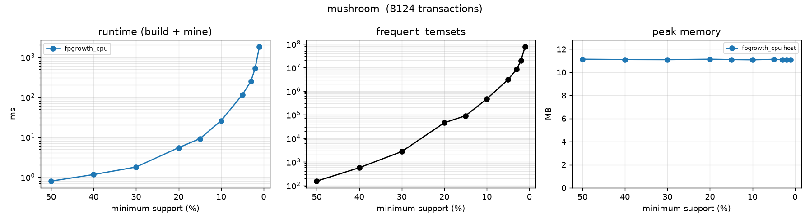
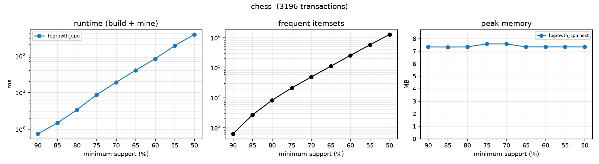
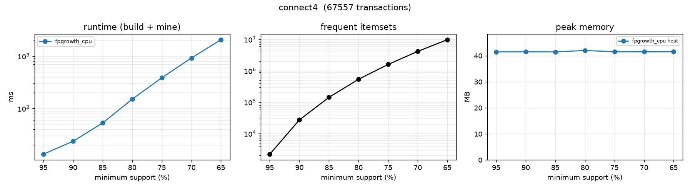
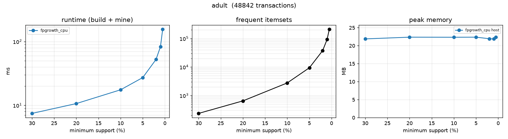

# ESE 327 Project 1 — FP-growth in C++ and CUDA

Frequent-itemset mining with the FP-growth algorithm (Han, Pei & Yin, SIGMOD 2000),
implemented twice:

| program | source | description |
|---|---|---|
| `fpgrowth_cpu` | `src/fpgrowth_cpu.cpp` | classic sequential FP-growth (FP-tree + recursive conditional FP-trees) |
| `fpgrowth_gpu` | `src/fpgrowth_gpu.cu` | data-parallel CUDA FP-growth (tree construction and mining on the GPU) |
| `fpgrowth_gpu_emu` | same `.cu` file | the CUDA code compiled by a plain C++ compiler with serial kernel emulation, used to validate the GPU algorithm on machines without an NVIDIA GPU |

Both programs read the same input, use the same item ordering, and write identical
results, so either can be used to check the other.

> Status: the CPU version and the emulated GPU version are built and validated
> (155/155 tests). The real CUDA build still has to be compiled and benchmarked on
> a machine with an NVIDIA GPU (see [Running on a GPU](#running-on-a-gpu)). The full
> report will follow; this README documents the design and the results so far.

## Repository layout

```
include/common.h        dataset loading, CLI, item ranking, output, timing/memory stats
include/cuda_compat.h   CUDA runtime / CUB wrappers + serial emulation for non-CUDA builds
src/common.cpp
src/fpgrowth_cpu.cpp    sequential FP-growth
src/fpgrowth_gpu.cu     CUDA FP-growth
src/fpgrowth_gpu_emu.cpp  builds fpgrowth_gpu.cu as plain C++
data/examples/          small hand-checked examples (+ expected outputs)
scripts/fetch_uci.py    downloads and converts the UCI benchmarks
scripts/bruteforce.py   independent Apriori reference miner (Python)
scripts/compare.py      compares two result files
scripts/run_tests.py    full correctness suite
scripts/benchmark.py    support sweeps -> CSV, Markdown table, plots
results/                benchmark output (bench.csv, summary.md, *.png)
```

## Building

Requirements: a C++17 compiler; for the GPU version, the CUDA Toolkit (11.6+ for
`-arch=native`, CUB is bundled with the toolkit). Python 3 + matplotlib for the scripts.

```bash
make            # fpgrowth_cpu + fpgrowth_gpu_emu, and fpgrowth_gpu if nvcc is on PATH
make gpu        # only the CUDA build
make gpu CUDA_ARCH=-arch=sm_75   # pick an architecture explicitly (e.g. T4 = sm_75, RTX 30xx = sm_86)
```

On Windows use `mingw32-make` with MSYS2/MinGW g++. For the CUDA build on Windows
(nvcc needs MSVC), use CMake from a Visual Studio developer prompt:

```bash
cmake -B build -DCMAKE_BUILD_TYPE=Release
cmake --build build --config Release      # builds fpgrowth_gpu when CUDA is found
```

## Usage

```
fpgrowth_cpu <transactions.txt> <minsup> [-o itemsets.txt] [--json] [--quiet]
fpgrowth_gpu <transactions.txt> <minsup> [-o itemsets.txt] [--json] [--quiet]
             [--max-entries N] [--max-cands N]
```

* **Input**: one transaction per line, items separated by whitespace. Any token is an item
  (`I1`, `42`, `odor=n`, ...). Duplicate items in a line are ignored.
* **minsup**: relative (`0.3` or `30%`) or an absolute transaction count (`3`).
  A relative support `s` means `ceil(s * #transactions)` transactions.
* **Output** (`-o`): one itemset per line, items sorted, followed by its support:
  `I1 I2 I5 #SUP: 2`. Without `-o`, itemsets are only counted (used for timing).
* Statistics: dataset size, FP-tree size, number of itemsets by length, time per phase,
  peak host memory (peak working set / max RSS) and, for the GPU, peak device memory
  allocated by the program. `--json` prints them as one JSON line.
* `--max-entries`/`--max-cands` bound the GPU working set per mining batch (default 8M each,
  roughly 0.5–0.8 GB of device memory at most).

Example:

```
$ ./bin/fpgrowth_cpu data/examples/han_textbook.txt 2 -o out.txt
frequent items   : 5
FP-tree nodes    : 11
frequent itemsets: 13   (size 1: 5, size 2: 6, size 3: 2)
$ cat out.txt
I4 #SUP: 2
I2 I4 #SUP: 2
I5 #SUP: 2
I2 I5 #SUP: 2
I1 I2 I5 #SUP: 2
...
```

## Algorithms

### Sequential FP-growth (`fpgrowth_cpu`)

1. **First scan**: count every item's support; keep items with support ≥ min count and rank
   them by descending support (ties broken by first appearance). Rank 0 = most frequent.
2. **FP-tree**: insert each transaction's frequent items, sorted by rank, into a prefix tree.
   Shared prefixes share nodes, and each node stores a count. Nodes with the same item are
   chained by node-links from a header table that also stores each item's total support.
   Tree nodes are stored in flat arrays (`item`, `count`, `parent`, first-child/next-sibling,
   node-link).
3. **Mining** `mine(tree, suffix)`: for each item `i` of the tree, from least to most
   frequent:
   * output `suffix ∪ {i}` with support = header count of `i`;
   * the **conditional pattern base** of `i` is the prefix path above every `i`-node,
     each weighted by that node's count. One pass over these paths counts the conditional
     support of each item. A second pass inserts the paths, keeping only items that are
     still frequent, into a new **conditional FP-tree**, which is mined recursively with
     suffix `suffix ∪ {i}`.
   * **Single-path shortcut**: if a (conditional) tree is a single chain, every subset of
     the chain is frequent. The support of a subset is the count of its deepest node, since
     counts never increase going down a path, so all subsets are enumerated directly.

Each conditional tree only contains items ranked before `i`, so header arrays shrink with
depth. Memory is dominated by the global FP-tree plus one conditional tree per recursion
level.

### CUDA FP-growth (`fpgrowth_gpu`)

The recursive, pointer-chasing structure of FP-growth maps poorly onto GPUs, so the GPU
version keeps the FP-tree / pattern-growth idea but expresses every step as flat,
data-parallel array operations (kernels plus CUB radix sort, scan and reduce-by-key):

| phase | parallelism | what happens |
|---|---|---|
| 1. item counting | one thread per item occurrence | `atomicAdd` into a support histogram; host ranks the frequent items |
| 2. ranking | one thread per transaction | drop infrequent items, insertion-sort the rest by rank (in place) |
| 3. FP-tree build | one thread per transaction, one pass per depth level | see below |
| 4. mining | one thread per conditional-pattern-base entry | see below |

**Tree construction without pointer insertion.** The FP-tree is exactly the prefix trie of
the ranked transactions. At depth `d`, every transaction longer than `d` forms the 64-bit
key `(node reached at depth d-1, its d-th item)`. The keys are radix-sorted. A flag/scan
pass then assigns one new node id to each distinct key (parent and item come from the key),
the node count is the number of transactions with that key, and each transaction records
its new node. After `max transaction length` levels the tree is complete, stored as flat
`parent[] / item[] / count[]` arrays on the device. It is identical to the CPU tree: same
number of nodes, same counts.

**Mining with pointer-based conditional pattern bases.** The conditional pattern base of
an itemset `P` is stored as a list of entries `(node, count)`, where `node` is the top of a
prefix path in the *global* tree. For a single item `i`, the entries are
`(parent(n), count(n))` for every `i`-node `n`. A batch of patterns is processed as follows:

1. **Count extensions**: one thread per entry walks from `node` to the root and atomically
   adds `count` to `support[P][j]` for each item `j` on the path. Only items ranked before
   the last item of `P` can appear there, so `P` needs `last(P)` counters.
2. **Select**: every `(P, j)` with `support ≥ min count` is a new frequent itemset `P ∪ {j}`
   (flags + exclusive scan + scatter). The pattern ids are copied to the host for output.
3. **Build child bases**: each entry walks its path again. Wherever a frequent extension
   `j` is found at node `a`, it emits `(child id, parent(a), count)`. Radix sort plus
   reduce-by-key then **merge identical prefix paths** and sum their counts. This is the
   same compression that node sharing gives a conditional FP-tree, and it keeps the
   bases small.
4. The child bases form new batches on a host-side stack processed depth-first. Small
   batches are concatenated and large ones split, so each GPU launch stays big enough to
   fill the device while memory stays bounded by `--max-entries` / `--max-cands`.

Because a pattern's base is a set of pointers into the one global tree, no conditional
trees are ever allocated, and every step is a regular kernel, sort or scan. The price is
that path walks also visit items that are infrequent in the conditional database; a CPU
conditional tree would have pruned them.

**Why this is correct**: entry `(node, c)` of `P` represents `c` transactions that contain
`P` and whose remaining (higher-ranked) frequent items are exactly the path from `node` to
the root. So the support of `P ∪ {j}` is the sum of `c` over entries whose path contains
`j`, which is what step 1 computes. Those transactions' remaining items are the path above
`j`'s node, which is what step 3 emits. This is the FP-growth recursion over conditional
pattern bases, with the same item order, so both programs produce the same set of itemsets
and supports.

**Emulation build.** `include/cuda_compat.h` maps `__global__`, `threadIdx`, `atomicAdd`,
device memory and the CUB primitives to serial C++ when `__CUDACC__` is not defined. All
kernels are grid-stride loops without shared memory or `__syncthreads`, so running a launch
as a single thread gives exactly the same results. This lets the whole GPU algorithm
(including batch splitting/merging) be tested without a GPU; its timings are not
meaningful.

## Validation

`python scripts/run_tests.py` runs every built binary (and the GPU binaries a second time
with tiny batch budgets, `--max-entries 7 --max-cands 5`, to force many batch splits and
merges) on:

1. **Textbook examples** with hand-checked results (`data/examples/`):
   * `han_textbook.txt` — Han & Kamber, *Data Mining*, Table 6.1 (9 transactions,
     min_sup = 2): 13 frequent itemsets, e.g. `{I1,I2,I5}:2`, `{I1,I2,I3}:2`. The FP-tree
     has 10 nodes plus the root, as in the book's figure.
   * `fp_paper.txt` — the running example of the original FP-growth paper (5 transactions,
     min_sup = 3): 18 frequent itemsets, e.g. `{f,c,a,m}:3`.
2. **45 randomized and edge-case datasets** (empty result, single transaction,
   identical transactions = single-path tree, nested chains, duplicate items, sparse/dense,
   skewed/uniform item distributions), each compared with an independent Python Apriori
   miner (`scripts/bruteforce.py`).
3. **UCI benchmarks**: Apriori vs. both programs at high support (mushroom 40%, chess 85%,
   adult 40%), and CPU vs. GPU at lower support (mushroom 15% = 90,325 itemsets, chess 75%,
   connect-4 90%, adult 10%), with default and with small (4096) batch budgets.

Current result: **155 passed, 0 failed** (`fpgrowth_cpu` and `fpgrowth_gpu_emu`).
As an external check, the counts also match published FIMI-repository figures for the same
UCI data: chess at 90% gives 622 itemsets and connect-4 at 95% gives 2,201.

## Benchmarks (UCI Machine Learning Repository)

`python scripts/fetch_uci.py` downloads and converts:

| dataset | UCI id | transactions | items | avg. length | conversion |
|---|---|---|---|---|---|
| mushroom | 73 | 8,124 | 118 | 22.7 | `attribute=value`, missing `?` dropped |
| chess (kr-vs-kp) | 22 | 3,196 | 75 | 37.0 | `attribute=value` |
| connect-4 | 26 | 67,557 | 129 | 43.0 | `attribute=value` (the `.Z` file is decoded by the script) |
| adult | 2 | 48,842 | 114 | 12.9 | train + test; age / hours / capital gain & loss binned; `fnlwgt`, `education-num` dropped |
| online retail (optional) | 352 | ~20k invoices | ~4k | ~20 | baskets of stock codes; needs `pip install openpyxl` |

`python scripts/benchmark.py` sweeps the minimum support per dataset, takes the median of 3
runs, and writes `results/bench.csv`, `results/summary.md` (all rows) and one figure per
dataset. Times are build + mine, excluding file reading and writing (itemsets are counted,
not written).

### CPU results (Intel Core Ultra 7 256V, 16 GB, Windows 11, g++ 14.2 -O3)

| dataset | min sup | frequent itemsets | longest | time (ms) | peak RAM (MB) |
|---|---|---|---|---|---|
| mushroom | 20% | 45,391 | 15 | 5.4 | 11.1 |
| mushroom | 5% | 3,082,619 | 17 | 114 | 11.1 |
| mushroom | 1% | 76,800,141 | 19 | 1,821 | 11.1 |
| chess | 80% | 8,227 | 10 | 3.4 | 7.3 |
| chess | 60% | 254,944 | 14 | 83 | 7.3 |
| chess | 50% | 1,272,932 | 16 | 379 | 7.3 |
| connect-4 | 90% | 27,127 | 12 | 23.5 | 41.5 |
| connect-4 | 75% | 1,585,551 | 17 | 386 | 41.5 |
| connect-4 | 65% | 9,724,531 | 19 | 2,061 | 41.5 |
| adult | 10% | 2,757 | 9 | 17.5 | 22.4 |
| adult | 1% | 93,294 | 11 | 83 | 21.9 |
| adult | 0.5% | 212,638 | 12 | 156 | 22.3 |






Observations so far:

* **Runtime tracks the output size.** Once support is low enough that mining dominates,
  time grows almost linearly with the number of frequent itemsets: about 40 M itemsets/s on
  mushroom and 4–5 M itemsets/s on connect-4, whose conditional trees are deeper and wider.
  At high support the cost is the two database scans and tree construction (e.g. adult:
  tree build ≈ 14 ms of the 17.5 ms at 10%).
* **Memory is flat.** Peak RAM is set by the input plus the global FP-tree (at most 72,770
  nodes here, for adult at 0.5%), not by the number of itemsets, because itemsets are streamed out instead of
  stored. Connect-4 uses more memory only because its input is larger (2.9 M item
  occurrences).
* **The GPU formulation does little extra work.** Run serially (emulation), the GPU
  algorithm takes 1.1–3.1× the time of the CPU algorithm on the same inputs (e.g. chess 70%:
  20 ms vs 18 ms; mushroom 10%: 93 ms vs 30 ms) in only 10–15 batches. The data-parallel
  version therefore performs a similar amount of total work as recursive FP-growth while
  exposing thousands of independent threads per launch.

### Running on a GPU

This machine has no NVIDIA GPU, so the CUDA binary has not been built here yet. On any
CUDA machine (lab workstation, or Google Colab with a T4 runtime):

```bash
git clone <this repo> && cd ESE_327_proj1
make gpu cpu                       # add CUDA_ARCH=-arch=sm_75 if -arch=native is unsupported
python3 scripts/fetch_uci.py
python3 scripts/run_tests.py       # now also checks fpgrowth_gpu against Apriori and the CPU
python3 scripts/benchmark.py       # CPU and GPU sweeps, adds a GPU speedup panel to each figure
```

## Remaining work for the report

* Build and benchmark `fpgrowth_gpu` on real hardware; report GPU time per phase, device
  memory, and speedup vs. support.
* Possible GPU optimizations to evaluate: shared-memory privatized counters for patterns
  with few candidates, warp-aggregated atomics, overlapping host bookkeeping with the
  next batch (CUDA streams), and keeping child batches resident on the device.
* Optional larger benchmarks: Online Retail and replicated versions of connect-4 to study
  scaling with the number of transactions.
